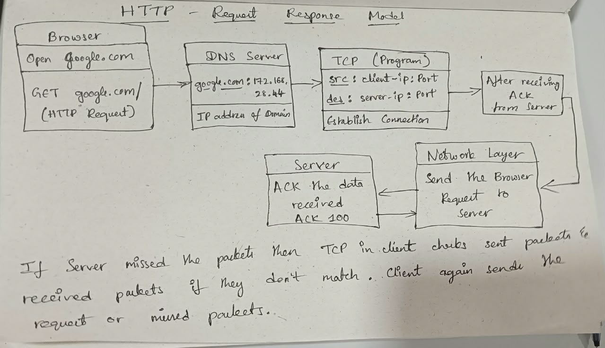

# HTTP - Protocol in Application Layer to send the requests over web.

## It uses TCP to establish the connection with the server before sending the request.

## **Transport Layer**: It mainly focuses on connecting two computer's applications or processes to transfer data between them and the transfer can be reliable or unreliable.

### Points to know about Transport Layer:
1. **Between processes:** It enables communication between applications on different computers.
2. **Port numbers:** They help the operating system deliver incoming data to the correct network endpoint.
3. **Delivery behavior:** TCP provides reliability and ordering; UDP does not guarantee delivery or ordering.

## How HTTP Request Response Model Works?

## Why we need to use JSON to send the data in HTTP request or response body?
- The type of data like Objects or Arrays exists in the system's memory which may contains the references and they cannot be shared to another compouter.
- So, JSON converts the data in a text or string format as sequence of chars and transmits the data.